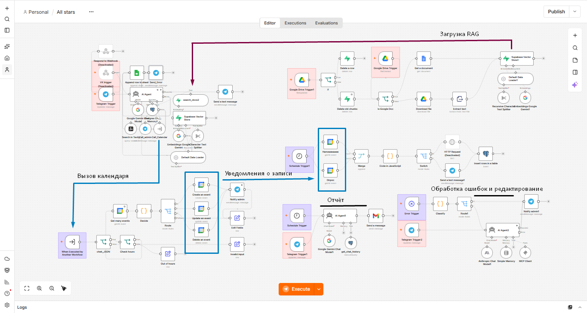
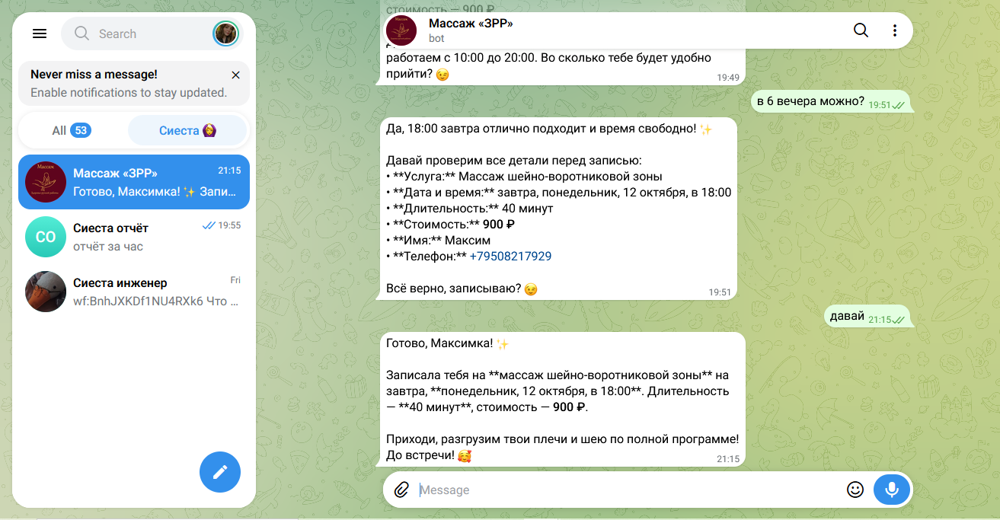
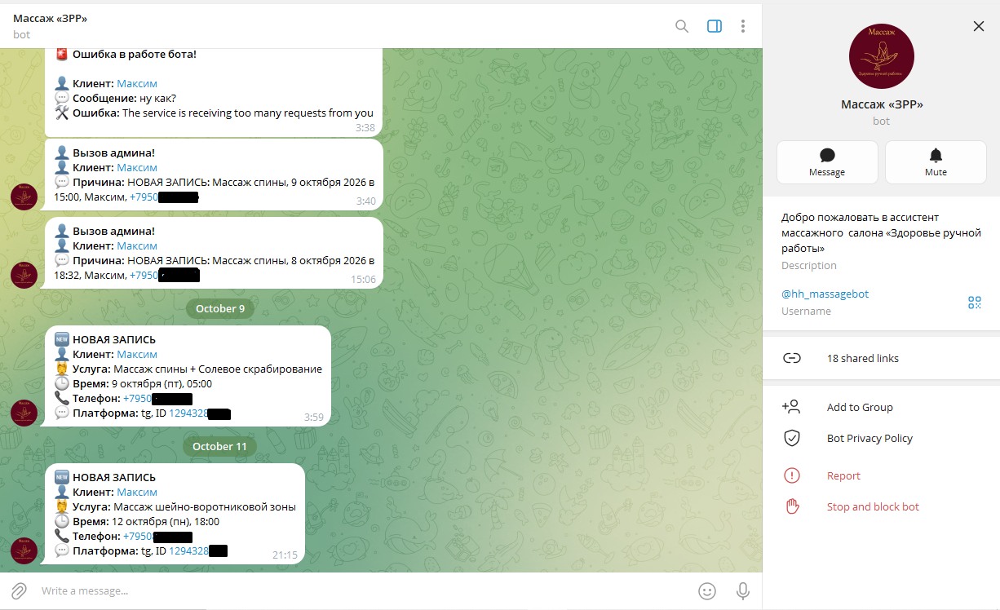
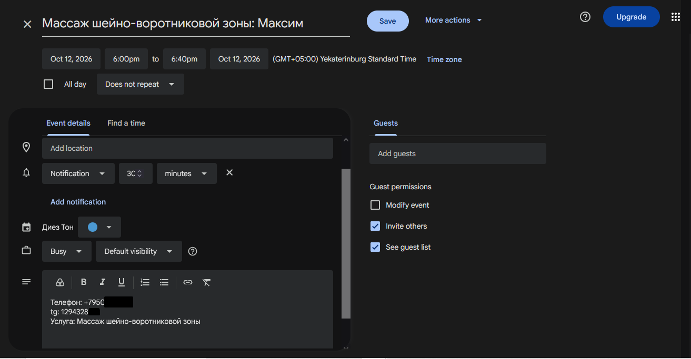
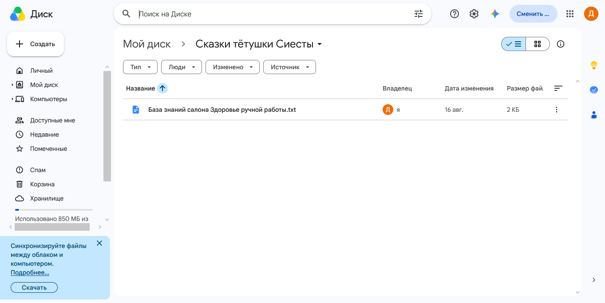
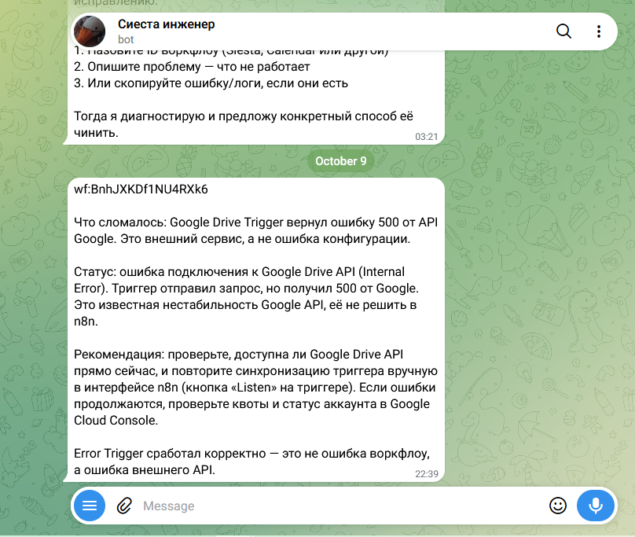
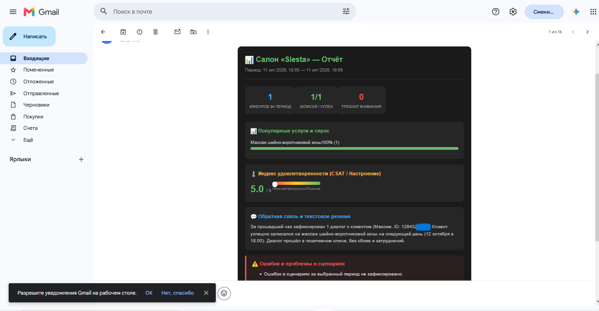

# Сиеста — AI-ассистент для салона массажа

Telegram-бот на [n8n](https://n8n.io) для салона «Здоровье ручной работы»: записывает клиентов в Google Calendar, отвечает по прайсу из базы знаний, напоминает о визитах, собирает отзывы, присылает отчёты и сам разбирает ошибки.

Автор: [endruPanda](https://github.com/endruPanda) · Telegram: [@Smartmanwithglasses_downloadwall](https://t.me/Smartmanwithglasses_downloadwall)

*Общая архитектура: 6 воркфлоу n8n и их взаимодействие*

## Что умеет

- **Запись, перенос и отмена** в Google Calendar. Проверяет часы работы (10:00–20:00) и занятые слоты, перед записью показывает клиенту итог и ждёт согласия.
- **Ответы по прайсу** из базы знаний (RAG). Документы в папке Google Drive автоматически попадают в векторную базу и обновляются при изменении.
- **Веб-поиск** (Tavily) для вопросов вне салона.
- **Напоминания и опрос**: за час до визита и через час после него.
- **Отчёты по диалогам** в виде HTML-письма: ежедневно или по запросу за любой период.
- **Вызов администратора** при конфликте или сбое календаря, уведомления о новых записях.
- **Самоисправление ошибок**: AI-агент разбирает упавший воркфлоу, предлагает правку и применяет её только после «да» администратора.

## Стек

n8n · Google Gemini (агент, эмбеддинги) · Claude Haiku через MCP n8n (разбор ошибок) · Supabase (Postgres + pgvector) · Telegram Bot API · Google Calendar, Drive, Sheets, Gmail · Tavily

## Демо

*Диалог с клиентом: память, RAG-поиск по прайсу, запись*

*Админ получает новые записи, вызовы и ошибки бота в отдельный чат*

## Ключевые решения

- **Слот проверяет код, а не LLM.** Нода `Decide` в `Calendar` сама находит конфликты, часы работы и неоднозначные записи. Агент только пересказывает результат (`status`, `decision`, `message`), поэтому не может «выдумать» свободное время.
- **Согласие перед действием.** Агент не вызывает `create`, `update` и `delete`, пока клиент не подтвердил итог записи. Фразы «Записала» и «Отменила» запрещены до `status: success`.
- **Уведомления админу шлёт воркфлоу, а не промт.** Календарь сам сообщает о записи, агент вызывает админа только по делу.
- **Агент ошибок ограничен.** Временные сбои и проблемы с ключами он только передаёт админу, остальное чинит после подтверждения и меняет только параметры названного узла.

## Воркфлоу

| Воркфлоу | Что делает |
|---|---|
| [`Siesta`](workflows/Siesta.json) | Основной AI-агент (Gemini, память в Postgres на 25 сообщений). Знает прайс из базы знаний, ведёт запись, зовёт админа. Ошибки уходят админу и в Google Таблицу |
| [`Calendar`](workflows/Calendar.json) | Саб-воркфлоу агента. Проверяет часы работы, ищет занятые слоты, решает create / update / delete / get, пишет в Google Calendar и уведомляет админа |
| [`Rag system`](workflows/Rag%20system.json) | Следит за папкой Google Drive, режет документы на части, делает эмбеддинги и кладёт в Supabase. Обновлённые и удалённые файлы синхронизирует |
| [`Alerts`](workflows/Alerts.json) | Каждые 30 минут: напоминание за час до записи и опрос через час после |
| [`Report`](workflows/Report.json) | HTML-отчёт по диалогам на почту: каждый день в 12:00 или по запросу в Telegram |
| [`Error scenario`](workflows/Error%20scenario.json) | Общий обработчик ошибок: уведомляет админа или предлагает правку через AI-агента |

*Проверка свободных слотов и запись в Google Calendar*

*Автоматическая загрузка документов и обновлений в векторное хранилище*

*Логирование ошибок и AI-агент, который правит воркфлоу по подтверждению*

*Формирование и отправка HTML-отчётов по диалогам на почту*

## Ограничения

- Вход через VK пока заготовка, работает Telegram.
- Запись принимается с 10:00 до 20:00 по Екатеринбургу, не дальше чем на 60 дней вперёд.
- События, созданные вручную без метки `tg: <ID>`, не получают напоминаний.
- MCP-токен в `Error scenario` даёт агенту доступ к воркфлоу инстанса. Правки применяются только после ответа админа, но токен стоит хранить как секрет.

## Запуск

Нужны n8n, Supabase и ключи Google Gemini, Tavily и Anthropic. Пошаговая установка, SQL для базы и список плейсхолдеров: **[docs/SETUP.md](docs/SETUP.md)**.

Из экспортов удалены ID чатов, почты, ID таблиц и папок, адрес инстанса и коды подтверждения. Ключи и токены в JSON не хранятся: они остаются в credentials n8n.
